<div align="center">



# ONYX

**A machined-black, AI-native IDE that runs in your browser.**

Monaco editor. Real terminal. Git bridge. An AI pair programmer that reads your
workspace and writes code straight into your files — all in one relentless,
zero-gradient dark canvas.

`Next.js 16` · `TypeScript 5` · `Monaco` · `xterm.js` · `socket.io` · `Z.AI`

</div>

---

## What is Onyx

Onyx is a Cursor-style development environment that lives entirely in a browser
tab. Open a file, edit it with a real language server underneath, run it in a
live shell, commit it with git, and pair with an AI that sees your workspace —
without ever leaving the page.

It is not a mockup. The terminal runs real `bash`. The commits are real git
commits. The AI edits are written to disk the moment you hit **Apply**.

## Features

**Editor**
- Monaco editor with a custom `onyx` theme — hand-tuned token colors on pure black
- Self-hosted Monaco workers: TypeScript IntelliSense, diagnostics, completions
- Multi-tab editing with dirty-state tracking, breadcrumbs and a minimap
- `Ctrl/Cmd + S` to save, `Ctrl + Click` file for anything else — full keyboard coverage

**Terminal**
- Real bash sessions streamed over socket.io — live stdout/stderr, exit codes
- Persistent working directory across commands, command history, `Ctrl+C` job kill
- Sandboxed to the workspace root — `cd ../..` will not save you
- One-click **Run** for the active file (bun / node / python3 / bash)

**Onyx AI — agent mode**
- Streaming chat powered by Z.AI (GLM) with an agent-grade system prompt
- **Writes files to disk by itself** — every `path=` code fence the model
  closes is auto-saved into the workspace the moment it lands. No Apply
  button, no copy-paste: build requests produce real files in `src/`
- Replies collapse each file into a compact **file card** — `saved · 62 ln` —
  expand to peek at the code, open it in the editor with one click
- The first written file auto-opens in the editor; explorer, git and live
  preview all refresh on their own
- `@` to attach workspace files as context; files referenced by path auto-attach
- Stop mid-generation or copy any block

**Live Preview**
- The workspace is served at `localhost/api/ide/preview/` — jailed static
  server with a full MIME map, directory index and sandboxed paths
- Auto-reload: every HTML page carries a revision poller, so the preview
  refreshes itself whenever any file changes — editor save, terminal or agent
- Side-by-side with the editor (`⌘⇧V`, title-bar or palette toggle),
  full-screen overlay on mobile, and "open in new tab" for the real thing
- Ask Onyx to "build a snake game" and watch it appear in the pane as the
  last file finishes writing

**Source Control**
- Live `git status` with change badges in the activity rail and status bar
- Stage-all + commit from the panel, with commit history viewer
- One-click repo init if the workspace is not a repository yet

**Workspace**
- Full file CRUD: create, rename, delete files and folders with context menus
- Workspace-wide search with case + regex toggles
- Editor settings (font size, tab size, word wrap, minimap) persisted locally

**Chrome**
- Command palette (`Ctrl/Cmd + K`) — commands and fuzzy file search
- Boot sequence, traffic lights, hairline seams, one electric-cyan signal
- Responsive: desktop panes resize; mobile gets overlay panels

## Architecture

```
┌─────────────────────────── Browser ────────────────────────────┐
│  Next.js 16 (App Router)                                       │
│  ├─ src/components/ide/*   — IDE shell, editor, chat, terminal │
│  ├─ src/app/api/ide/*      — filesystem · search · git bridge  │
│  │                           · live preview server             │
│  └─ Zustand                — single IDE state tree             │
└──────────────┬────────────────────────────┬────────────────────┘
               │ REST (JSON)                │ socket.io (gateway)
┌──────────────▼──────────────┐  ┌──────────▼───────────────────┐
│  /api/ide/fs                │  │  ide-server (port 3003)      │
│    jailed to workspace root │  │  ├─ real bash sessions       │
│  /api/ide/search            │  │  └─ Z.AI streaming chat      │
│    line-level hits          │  │      (GLM · stream: true)    │
│  /api/ide/git               │  └──────────────────────────────┘
│    status · log · commit    │
└─────────────────────────────┘
```

- **Sandboxing** — every path is resolved and jailed inside
  `ide-workspace/`; traversal is rejected at the API layer
- **No CDN dependency** — Monaco is self-hosted from `public/monaco` with a
  blob-bootstrap worker fix for the AMD loader
- **Socket contract** — the IDE client connects via
  `io("/?XTransformPort=3003")` and never touches a raw port

## Quick start

```bash
# 1. install
bun install

# 2. self-host monaco assets (already gitignored)
mkdir -p public/monaco && cp -r node_modules/monaco-editor/min/vs public/monaco/vs

# 3. web app (port 3000)
bun run dev

# 4. ide-server — terminal + AI (port 3003)
cd mini-services/ide-server && bun install && bun run dev
```

Open the app, wait for the boot sequence, and start editing the seeded
`nebula-demo` workspace. Type in the terminal, hit **Run**, ask Onyx AI
to refactor something, then **Apply** it.

> The AI needs `z-ai-web-dev-sdk` credentials in the environment.

## The workspace

`ide-workspace/` is a real, seeded project with its own git repository:

```
ide-workspace/
├── src/
│   ├── main.ts        # runnable entry
│   └── utils.ts       # fibonacci, greet — try "add a memoized variant"
├── package.json
└── README.md
```

Point `IDE_WORKSPACE` at any directory to open a different project.

## Tech stack

| Layer         | Tools                                            |
| ------------- | ------------------------------------------------ |
| Framework     | Next.js 16 (App Router), React 19, TypeScript 5  |
| Editor        | Monaco Editor (self-hosted, custom theme)        |
| Terminal      | xterm.js + socket.io + real bash                 |
| AI            | Z.AI (GLM) streaming chat completions            |
| State         | Zustand                                          |
| Styling       | Tailwind CSS 4 — flat black canvas, zero gradients |
| Type          | Space Grotesk · JetBrains Mono · Unbounded       |

## Design doctrine

1. **Black owns the screen.** Layered solids (#030303 → #060606 → #0e0e0e),
   never a gradient.
2. **One signal color.** Electric cyan `#00e5ff` — cursor, focus, the live dot.
   Everything else is ink: white, gray, gone.
3. **Type is the interface.** Unbounded for the wordmark, Space Grotesk for the
   chrome, JetBrains Mono for everything a developer reads.
4. **Real beats fake.** Real shell, real git, real files on real disk.

---

<div align="center">
<sub>ONYX — carved from black. Powered by Z.AI.</sub>
</div>
