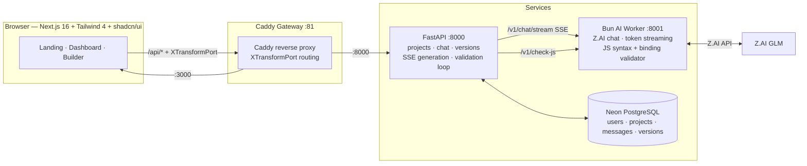
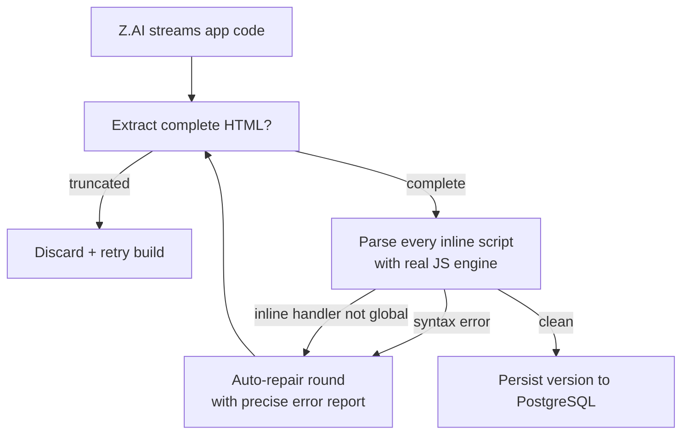
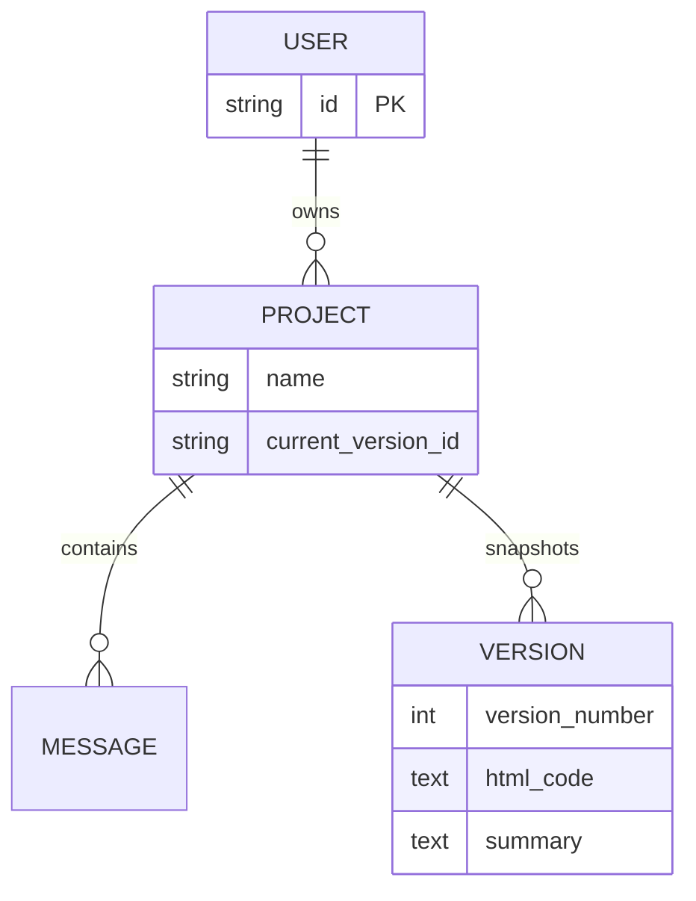

<div align="center">


# Buildora

**An AI app-builder platform where one sentence becomes a stunning, working web app — then refines it through conversation.**

[](https://nextjs.org)
[](https://fastapi.tiangolo.com)
[](https://z.ai)
[](https://neon.tech)
[](LICENSE)

*Describe it. Watch it ship.*

</div>

---

## What is Buildora?

Buildora is a **Lovable / Base44-class AI app builder** — you describe an app in plain language, Z.AI architects it, and you watch the code stream into existence token by token. Then you keep chatting: *"make the header glassy"*, *"add dark mode"*, and every message intelligently rewrites your app while preserving everything that works.

```text
You:  "build a simple calculator with history and a sleek dark design"

      ✦ Connecting          ✓ Planning           ✓ Writing code        ✓ Polishing

      BUILD BLUEPRINT ── Dark Calc · "Calculate in the dark" · minimalist tech
      ✓ Real-time calculation display   ✓ Persistent history log
      ✓ Dark mode toggle                ✓ Memory functions

      [ code streaming live... 18,680 characters · 38s ]

      → v1 is live in the preview. Chat to refine. Download when done.
```

## Why Buildora is different

| | Buildora | Typical AI builders |
|---|---|---|
| **Planning** | Visible blueprint (name, features, palette, vibe) before code | Black box |
| **Code streaming** | True token-level SSE — watch every character land | Wait in silence, then dump |
| **Self-healing builds** | Every build is parsed with a real JS engine; broken syntax *and* dead event bindings are auto-repaired before you ever see them | Ship broken code, you debug |
| **Truncation guard** | Incomplete documents are never saved; builds auto-retry and lift output limits to 16K tokens | Mysterious half-apps |
| **Version time machine** | Every build snapshotted to cloud PostgreSQL, one-click restore | Often paid-tier only |
| **Live thumbnails** | Dashboard renders your actual apps in scaled iframes | Static icons |
| **Code ownership** | Single-file HTML export, zero lock-in, no watermarks | Walled gardens |

## Features

- **Blueprint before code** — Z.AI plans the name, tagline, feature set, palette and visual vibe, shown as a beautiful card in chat before a single line is written.
- **True streaming** — a Bun AI-worker relays Z.AI token deltas through FastAPI SSE straight into the code panel. No fake chunked playback.
- **Chat-driven iteration** — every message is a full-app rewrite that preserves what works and upgrades the polish.
- **Self-healing pipeline** — inline `<script>` blocks are parsed with a real JS engine; syntax errors and inline handlers bound to non-global functions are detected and auto-repaired (max 2 rounds) *before* the version is saved.
- **Completeness guard** — a build only ships if the document actually closes with `</html>`; truncated output is retried, never persisted.
- **Version time machine** — every build is a row in PostgreSQL; restore any version from the History menu.
- **Workspace** — resizable panels, syntax-highlighted code view with line numbers and file stats, desktop/mobile viewports, fullscreen mode, open-in-new-tab, one-click download, project rename, search, sort, grid/list layouts.
- **Resilient by design** — if the backend is restarting, the frontend boots it and retries transparently (the 502 era is over).

## Architecture



**The self-healing loop:**



## Quickstart

```bash
# 1. Frontend (Next.js 16)
bun install
cp .env.example .env           # optional: only for Prisma local dev
bun run dev                    # http://localhost:3000

# 2. AI worker (Bun + Z.AI)
cd mini-services/ai-worker
bun install
bun run dev                    # listens on :8001

# 3. FastAPI backend
cd mini-services/api
pip install -r requirements.txt
cp .env.example .env           # put your Neon PostgreSQL URL here
./run.sh                       # or: uvicorn main:app --port 8000 --reload
```

Open the app and type: *"a habit tracker with streaks and a weekly heatmap"* — then watch it ship.

> The Next.js boot endpoint (`/api/boot`) auto-spawns and health-checks both mini-services, so the frontend is self-healing in dev too.

## Environment

| Service | File | Key | Purpose |
|---|---|---|---|
| FastAPI | `mini-services/api/.env` | `DATABASE_URL` | Neon PostgreSQL connection string |
| FastAPI | `mini-services/api/.env` | `AI_WORKER_URL` | defaults to `http://127.0.0.1:8001` |
| Frontend | `.env` | `DATABASE_URL` | only needed for Prisma tooling |

`.env` files are git-ignored. `Z.AI` credentials are read by `z-ai-web-dev-sdk` from its own config.

## API reference

| Method | Route | Description |
|---|---|---|
| `GET` | `/api/health` | Liveness + database check |
| `POST` | `/api/users` | Create/fetch an anonymous workspace user |
| `GET` | `/api/projects?user_id=` | List projects with version counts |
| `POST` | `/api/projects` | Create project from a prompt |
| `GET` | `/api/projects/{id}` | Full detail: messages, versions, current HTML |
| `PATCH` | `/api/projects/{id}` | Rename / update description |
| `DELETE` | `/api/projects/{id}` | Delete project + cascade |
| `GET` | `/api/projects/{id}/preview` | Raw generated app as HTML (new tab, thumbnails) |
| `POST` | `/api/projects/{id}/chat` | Append a user message |
| `POST` | `/api/projects/{id}/generate` | **SSE stream**: `status` → `plan` → `chunk*` → `done` |
| `GET` | `/api/projects/{id}/versions` | Version list |
| `POST` | `/api/projects/{id}/restore` | Restore a version |

## Project structure

```text
├── src/
│   ├── app/                    # Next.js App Router (single-page orchestrator)
│   │   ├── api/boot/           # self-healing mini-service supervisor
│   │   └── page.tsx            # view routing: landing → dashboard → builder
│   ├── components/buildora/    # landing, dashboard, builder workspaces
│   └── lib/                    # gateway API client, SSE parser, Zustand store
├── mini-services/
│   ├── api/                    # FastAPI: models, schemas, prompts, generation
│   └── ai-worker/              # Bun: Z.AI chat, token streaming, JS validator
├── docs/                       # animated brand assets
└── prisma/                     # optional local Prisma tooling
```

## Data model



## Roadmap

- [ ] Supabase Auth (Google / GitHub sign-in)
- [ ] Multi-file exports (Vite project scaffold)
- [ ] Image-to-app (screenshot → rebuild)
- [ ] Realtime collaboration on the builder canvas
- [ ] One-click deploy targets (Vercel / Netlify)

## License

MIT — see [LICENSE](LICENSE).

---

<div align="center">

**Built with [Z.AI](https://z.ai) as the brain · FastAPI as the spine · Next.js 16 as the face**

If Buildora impressed you, star the repo — it helps more than you know.

</div>
